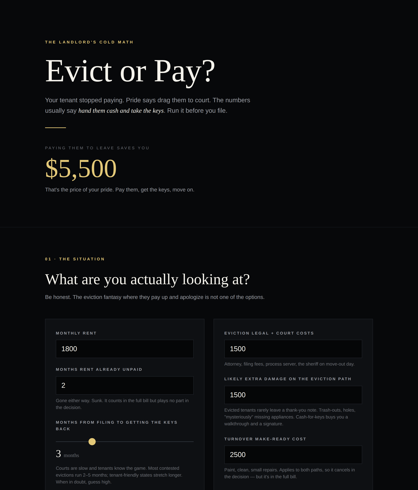

# Evict or Pay?

**Live:** https://thebullbrew.github.io/evict-or-pay/

## What it does

Your tenant stopped paying. Pride says drag them to court — this calculator runs the actual numbers on the two paths first:

- **Path A — Evict:** rent lost during the eviction timeline + attorney/court costs + the extra damage evicted tenants tend to leave
- **Path B — Cash for keys:** the offer you'd pay them to be out in 14 days, unit broom-clean, keys in your hand

It itemizes the full bill for both paths (with already-unpaid rent greyed out as sunk, because it counts in the total but plays no part in the decision), then delivers a verdict — **PAY THEM**, **EVICT**, or **TOSS-UP** — plus your **break-even offer**: the maximum cash-for-keys number that still beats eviction on pure math.

Also included: a sensitivity table showing how the answer tilts as the eviction timeline stretches from 1 to 9 months, saveable per-unit scenarios (localStorage), and a one-click copy summary for your records.

## The method behind it

The decision math is forward-looking only. Sunk rent is gone on both paths; turnover make-ready applies to both, so it cancels. What's left is the honest comparison:

> **eviction forward cost** = months-to-possession × rent + legal + damage risk
> **cash-for-keys forward cost** = offer + ~14 days lost rent

An eviction rarely recovers back rent — a judgment against someone who can't pay rent is a souvenir, not an asset. Cash-for-keys buys the only things that matter: the keys, a clean unit, and a paying tenant back in fast. The exception is the principle landlord, and that's a hobby, not a business.

Built in dark aesthetic variation 13 — **Obsidian Club**: near-black minimalism, platinum-gold reserved for the numbers that matter.

## Run it

No build step, no backend. Open `docs/index.html` in any browser (works from `file://`), or serve `docs/` with any static host. Installs as a PWA and works offline.
